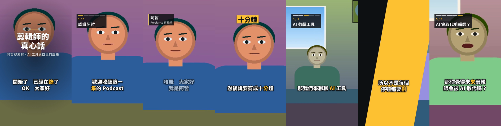

# video-editor

**A fully automatic video editor, in development.** The goal: drop in your footage, choose a length and an aspect ratio, and get back a finished video, cut, captioned, framed, graded and animated, with no manual steps. It is built for Mandarin, English and speech that switches between them. Captions come out in Taiwan Traditional Chinese.

[](https://github.com/zcxy-dev/video-editor/actions/workflows/ci.yml)
[](LICENSE)

> **Status:** the analysis worker, the planner, the renderer with its captions and effect templates, the `pnpm edit` command that runs them from footage to a finished video, the web page in front of it, the agent skill that changes a finished edit by conversation, and the benchmark work today.



*Frames from a five-minute 9:16 edit of a synthetic two-person podcast, made with `pnpm edit` and no manual steps: a title, chapter markers, a lower third for the guest, a keyword highlight, a wipe into a chapter and captions lit word by word.*

## Design

```text
footage/ (any number of clips)  +  length (15 s … 1 h)  +  aspect (9:16 · 1:1 · 16:9)
        │
        ▼
analyze     shots · speech and pauses · transcript with word timings · faces · audio events
plan        pick the best takes, remove fillers and dead air, fit the requested length
render      cuts · framing · colour · voice · music · animated captions · effects · loudness
check       review every cut, fix what is wrong, at most three passes
        │
        ▼
finished.mp4  +  captions.srt
```

A single web page drives it: drop the files, pick the length and aspect ratio, press start, and download the result.

## What works today

| Part | Status |
|---|---|
| **Probe:** displayed size of rotated phone footage; pixel shape, so anamorphic footage such as HDV's 1440 × 1080 is framed as the 16:9 it shows; HDR transfer and colour matrix; every audio track; cover art ignored | ✅ |
| **Shot detection:** [TransNetV2](https://github.com/soCzech/TransNetV2) finds hard cuts on the new shot's first frame and dissolves as spans | ✅ |
| **Speech and pauses:** [Silero VAD](https://github.com/snakers4/silero-vad), with times kept unrounded | ✅ |
| **Loudness and audio events:** EBU R128 momentary and short-term loudness for every second, at 48 kHz with each channel weighed as BS.1770 does, reading what FFmpeg's meter reads to 0.1 LU on synthetic speech, music and noise; laughter, applause and music as timed events with a confidence, from the [CED](https://github.com/RicherMans/CED) AudioSet tagger. Music is checked on synthetic audio; laughter and applause are not yet measured on real footage | ✅ |
| **Faces and who speaks:** [YuNet](https://huggingface.co/opencv/face_detection_yunet) faces tracked through each shot; each shot classed as one person, two people, a group, a webcam over a screen, or a screen; and who speaks when, from whose mouth moves while Silero hears speech, a speaker turned aside towards a listener included. Measured on the synthetic corpus ([details and numbers](worker/README.md#faces-and-speakers)); real footage is not scored yet | ✅ |
| **Long sources:** frames stream through shot detection and the audio is decoded once for the analyses at 16 kHz and once for the voice at 48 kHz, so a 2-hour 1080p60 file peaks at about 1.3 GB through shot detection and about 2.7 GB while its speech is denoised, and the face stage takes 0.4 GB for 2 hours as for 2 minutes ([voice](worker/README.md#voice)), before transcription adds the speech model's memory (below) | ✅ |
| **Transcript:** [Qwen3-ASR](https://github.com/QwenLM/Qwen3-ASR) in sentence-sized chunks, so mixed Mandarin and English is not forced into one language. Converted to Taiwan Traditional Chinese with [OpenCC](https://github.com/BYVoid/OpenCC); words and punctuation timed by Qwen3-ForcedAligner, then each word edge placed from the audio below the aligner's grid ([word timings](worker/README.md#word-timings)). For a machine without the memory for the local model, `--asr cloud` has Qwen3-ASR-1.7B hear the speech through OpenRouter, with your own key, for about US$0.03 an hour of source, and still times the words locally. On the synthetic corpus it read more words right than the local CPU model (2.97 % against 3.71 % MER) and peaked at 3.3 GB instead of 9.7 ([cloud speech](worker/README.md#cloud-speech)) | ✅ |
| **Transcript correction** (opt-in): Claude fixes misheard names, terms and homophones from the neighbouring sentences, the title and a glossary before the words are timed. Edits that would add, drop or re-script a spoken word are rejected, and every proposal is recorded in the index. The glossary can also bias the speech model itself ([details](worker/README.md#transcript-correction)). Neither effect is measured on the corpus yet | ✅ |
| **Plan:** [Claude plans the edit](packages/engine/README.md#planning) from the media indexes of any number of files and a length from 15 s to 1 h: story order across files, the best take of each line, fillers and false starts cut, B-roll over long talking stretches and the moments to emphasise. Code places every cut between words, in a pause and on the frame grids, fits the length by priority, as near the target as whole lines and pauses allow and within ±5 %, and writes captions for the kept speech. It hides jump cuts with punch-ins and pushes in on the moments to emphasise, enlarging footage without pixels to spare by at most 1.2 times ([framing](packages/engine/README.md#planning)), matches cameras that frame the same scene and puts a designed look over the edit ([colour](packages/engine/README.md#colour)). After each render, Claude checks every cut on a strip of frames and waveform and fixes what it finds, at most three times. `--quality economy` plans with Claude Sonnet instead of Opus for half the cost, US$0.07 against 0.14 an edit; on the synthetic corpus its edits are as clean, every length within ±5 % with no cut inside a word, no dead air and the right takes ([numbers](packages/engine/README.md#quality-measurements)); people have not compared their stories yet. Measured on the synthetic corpus ([numbers](packages/engine/README.md#planner-measurements)); take choices are not yet compared with a person's on real footage | ✅ |
| **Framing:** the planner frames every clip in the edit's shape with a [virtual camera](packages/engine/README.md#framing) that follows whoever speaks, keeps two or more people together when they fit, holds still inside a dead zone, pans with eased, speed-limited moves and cuts at shot changes; screen recordings get a still crop | ✅ |
| **Render:** [`project.json` to MP4](packages/engine/) with cuts, dissolves, dips, B-roll, framing that holds still or pans frame by frame, punch-ins and push-ins, a bounded auto grade, colour matching, looks and two-pass loudness. Rotated, HDR and variable-frame-rate footage comes out upright, in BT.709 and at one frame rate. Every cut is frame- and sample-exact, with no clicks and no audio drift ([measurements](packages/engine/README.md#measurements)). MP4, Matroska and WebM footage plays on its media index's timeline, to the millisecond. Matched cameras land within the ΔE00 bar on synthetic footage; real multi-camera footage is not matched yet ([colour measurements](packages/engine/README.md#colour-measurements)) | ✅ |
| **Music:** background music only from tracks you supply, each with the licence you state for it. [`vework analyze-music`](worker/README.md#music) finds tempo, beats and downbeats, sections and loudness. The planner has Claude pick the track and section that fit the content's mood; code fits it to the length on whole phrases, ending on the track's own ending or a fade, and ducks it under speech so the voice stays at least 18 dB over it, quieter speakers included, with B-roll cuts on the beat ([details](packages/engine/README.md#planning)). `pnpm edit --music` takes the tracks, each with its licence in a text file beside it, and writes the licences next to the video. Measured on synthetic music and edits and on a corpus talk show with licensed tracks ([numbers](packages/engine/README.md#music-measurements)); people's ratings are not measured yet | ✅ |
| **One command:** [`pnpm edit`](packages/engine/README.md#editing-footage) turns a folder of footage, and music if you give it, into the finished video at the length and aspect asked (9:16, 1:1 or 16:9): each file is analysed once and cached, then the edit is planned, rendered with its captions, music and effects, and every cut reviewed. Progress comes out as JSON lines for the web page. Measured on synthetic footage and on openly licensed interviews and talks ([numbers](packages/engine/README.md#edit-measurements)); cuts in the real footage are checked against the analysis's own word timings until its transcripts are corrected | ✅ |
| **Web page:** [one page](apps/web/README.md), started from a fresh clone with `mise run start`, runs `pnpm edit` on footage dropped in as files or folders, with any audio files among them offered as music under one licence you state: a length preset or any length from 15 s to 1 h, the aspect, a style and names and terms; live progress by stage, with each model's download on its first use (size, percentage, time left); the video in the page with the track it plays, and MP4 and SRT downloads. The first time, it asks for the Anthropic API key and checks it; it estimates what Claude will cost before an edit and shows what planning and the cut checks cost after. Failures its owner can fix (the key, the disk, a file it cannot read, the connection) say what to do. One edit at a time; a reload reopens the edit from its address | ✅ |
| **Changing an edit:** [`pnpm render`](packages/engine/README.md#rendering) renders an edit's `project.json` again, without analysing or planning, after a change to it, and names every problem of a changed project by its JSON path. `--cut` takes stretches out of the video: the words said in them go, each new cut lands in a pause, and the captions, overlays, B-roll and music move up with the speech. The [agent skill](#use-it-from-an-ai-agent) has Claude Code, Codex and other agents make an edit and change it by conversation: cut or trim a part, fix a caption, change the title or a lower third, remove or add a keyword or chapter, change the music's level or remove it, and change the look. Checked on a synthetic 60 s edit, changed three times by an agent that had only the skill ([details](packages/engine/README.md#changing-an-edit)) | ✅ |
| **Effects:** six animated templates for Traditional Chinese and English text: a title, a lower third, a keyword highlight, a chapter marker, a screen-recording callout and a wipe over a cut. They are rendered with [Remotion](https://www.remotion.dev) as transparent video and laid over exactly the frames each covers, cached once rendered ([details](packages/effects/)). Planned edits use all six sparingly: Claude picks keyword pops for the strongest moments, a title for a long edit, chapters for an edit of two minutes or more, each marked as it starts with a wipe over the cut into it, lower thirds for people named in `--names`, and callouts on screen recordings where the speaker names a button or field. Code times each on the speech, one at a time. For a callout, Claude boxes the thing on the one frame shown as it is named, for about US$0.0002 a callout, cached; code leaves it out when the thing is not there, moves, or falls outside the crop. Measured on the synthetic screen recording ([details](packages/engine/README.md#planning)) | ✅ |
| **Captions:** [burned in word by word](packages/engine/README.md#captions) as the speech was said, in Taiwan Traditional Chinese with English words kept in English. Four presets; rows break at pauses and between words, never inside an English word, with no closing punctuation starting a row; each word lights on the frame it is said; a caption moves off a face under it. A SubRip file beside the video matches the picture. Checked by eye on synthetic footage and one corpus clip; not yet rated in the blind review | ✅ |
| **Studio voice:** vework measures each source's speech (the room's noise floor, loudness and its range, clipping, reverberation, boom and presence) and removes its noise and much of the room with [DeepFilterNet3](https://github.com/Rikorose/DeepFilterNet). The engine chooses each source's chain from those measurements: denoising only as far as the room needs, a light de-reverb only where the room is still heard, an 80 Hz high-pass, EQ, a leveller where the level wanders, compression to one speech level for every source, de-essing and a peak limiter. Loudness is then -14 LUFS for 9:16 and 1:1 and -16 for 16:9, at -1 dBTP. Music is set under the processed voice. Measured on deliberately degraded synthetic clips and three noisy corpus clips: the room 12 to 25 dB further under the speech, a talk show's loudness range from 13 to 16 LU down to 3.6 and 3.7, no clicks or drift at cuts and word timings unchanged ([numbers](packages/engine/README.md#voice-measurements)); hand-checked transcripts and a blind review are still to judge it | ✅ |
| **Benchmark:** mixed-script error rate, timing error, shot precision/recall/F1, how often the person talking is named, clicks and A/V drift, the voice's lead over music, beat tracking, and for a planned edit its length, cuts inside words, filler precision/recall, retake choice, dead air, edges near a beat and callouts on their target, pooled across a corpus | ✅ |
| **Blind review:** a local page plays each edit alone, or two versions of it side by side under neutral labels, and records 1–5 ratings in seven categories, plus which of two versions the rater would rather post. The report gives the mean of each category and the preference rates ([details](bench/README.md#blind-review)) | ✅ |
| **File formats:** [JSON Schemas](packages/schema/) for the media index, `project.json` (the whole edit, timed in exact ticks) and progress lines, with generated TypeScript types and validators. The worker validates every index it writes | ✅ |
| **Ground truth drafts:** `vework draft-truth` transcribes a corpus clip for a person to correct; the benchmark refuses a draft nobody corrected | ✅ |
| **Synthetic corpus:** [`vebench synth`](bench/README.md#synthetic-corpus) generates talks, a three-camera conversation, a portrait phone walk and screen recordings, with exact truth for words, shots, fillers, pauses, retakes, story order and who speaks on screen, plus music with known beats and sections | ✅ |

Analysis and rendering run locally. Planning sends Anthropic each file's transcript with its name, length, frame size, shot changes, pauses, loudness peaks and audio events, the names and terms you list, and for music you offer, each track's file name, length, tempo, sections' loudness and licence name. The review after each render sends, for every cut, a picture of eight frames and the waveform of the two seconds around it, with the words on either side. For each callout planned on a screen recording, one frame of it is sent with the line said over it. Transcript correction, when you turn it on, sends the transcript, the video's title (by default the file name) and your glossary. Cloud speech, when you turn it on, sends OpenRouter the speech itself, as audio in chunks of at most 30 s, for the model's provider to transcribe. No video file is uploaded, and no audio without cloud speech.

## Quick start

**Requirements:**
- [mise](https://mise.jdx.dev), which installs the pinned Node, Python and `uv`; Node's corepack then provides the pinned pnpm.
- About 2 GB for the Python environment, plus the model weights downloaded on first use (3.4 GB for the speech model on a CPU).
- An [Anthropic API key](https://console.anthropic.com/settings/keys): Claude plans the edit and checks its cuts, about US$0.05 to 0.15 an edit.

```bash
git clone https://github.com/zcxy-dev/video-editor.git
cd video-editor
mise run start
```

`mise run start` installs the tools, the packages and the Python environment, builds the [web page](apps/web/README.md), starts it on 127.0.0.1 and opens it in the browser. mise asks once to trust the repository's `mise.toml`. The first time, the page asks for the API key, checks it with Anthropic and keeps it in the git-ignored `.env`. Run it again the same way; with mise [activated](https://mise.jdx.dev/getting-started.html) in your shell, `pnpm start` does the same.

From the command line, once `mise run start` has set things up (or after `mise install`, `pnpm install` and `uv sync --extra ml` in `worker/`), with the key in `.env` (copy `.env.example`):

```bash
pnpm edit footage/ --length 60s --aspect 9:16 -o out/edit.mp4
```

`pnpm edit --help` lists the options; [`packages/engine`](packages/engine/README.md#editing-footage) says what the command writes and how it reports progress. The analysis on its own writes one file's media index:

```bash
cd worker
# Shots, speech, a transcript with word timings, loudness, audio events, faces and who speaks,
# and voice measurements, with the denoised speech beside the index (talk.voice.wav).
uv run vework analyze talk.mp4 -o talk.index.json
```

The [media index format](packages/schema/media-index.schema.json) is defined with the other file formats in [`packages/schema`](packages/schema/).

**Which speech model runs:**

| Model | Weights to download | Speed on 8 cores of an EPYC 9355P | Peak memory |
|---|---|---|---|
| Qwen3-ASR-0.6B | 3.4 GB | ~1.3× the clip's length | ~9 GB |
| Qwen3-ASR-1.7B | 5.9 GB | ~14× the clip's length | ~14 GB |

| `--asr cloud` | 1.8 GB (the aligner) | ~0.5× the clip's length, with OpenRouter responding quickly | ~3.3 GB |

Weight sizes include the aligner. `vework` uses 1.7B with a CUDA GPU and 0.6B otherwise; `--asr-model` overrides that. With `--asr cloud` (`pnpm edit --asr cloud`), OpenRouter hears the speech and only the aligner runs here. The key goes in `.env` as `OPENROUTER_API_KEY` ([cloud speech](worker/README.md#cloud-speech)). On Linux, the lockfile installs a CPU-only PyTorch, so the models run on the CPU there.

To plan or render on its own, see [`packages/engine`](packages/engine/). To score outputs against ground truth, see [`bench/`](bench/).

## Use it from an AI agent

The [`video-editor` skill](skills/video-editor/SKILL.md) teaches Claude Code, Codex and other agents that read [Agent Skills](https://agentskills.io) to run the editor: check the setup, make an edit, and then change the finished edit as you ask for it, such as "cut the part about pricing", "the caption says 阿者, it should be 阿哲", "call it 剪輯師的一天" or "turn the music down". Each change edits the edit's `project.json` and renders it again, without analysing or planning again, into a new version beside the last.

Set up the clone as in the [quick start](#quick-start), then link the skill into your agent's skills folder from the clone:

```bash
# Claude Code
mkdir -p ~/.claude/skills && ln -s "$PWD/skills/video-editor" ~/.claude/skills/video-editor
# Codex
mkdir -p ~/.agents/skills && ln -s "$PWD/skills/video-editor" ~/.agents/skills/video-editor
```

Start a new session and ask it to edit a folder of footage, or to change an edit you made. A `git pull` in the clone updates the skill with the editor.

## Contributing

Setup, checks and the rules every change follows are in [CONTRIBUTING.md](CONTRIBUTING.md). Report security issues as described in [SECURITY.md](SECURITY.md).

## Acknowledgements

The editor is built on these models and libraries: [Qwen3-ASR and Qwen3-ForcedAligner](https://github.com/QwenLM/Qwen3-ASR) for the transcript, [TransNetV2](https://github.com/soCzech/TransNetV2) for shots, [Silero VAD](https://github.com/snakers4/silero-vad) for speech, [CED](https://github.com/RicherMans/CED) for audio events, [YuNet](https://github.com/ShiqiYu/libfacedetection.train) for faces, [Beat This!](https://github.com/CPJKU/beat_this) for beats, [DeepFilterNet](https://github.com/Rikorose/DeepFilterNet) for the voice, [OpenCC](https://github.com/BYVoid/OpenCC) for Traditional Chinese, [FFmpeg](https://ffmpeg.org) and libass for rendering, [Remotion](https://www.remotion.dev) for the effects, [Next.js](https://nextjs.org) for the web page, [Noto CJK](https://github.com/notofonts/noto-cjk) and [Inter](https://github.com/rsms/inter) for type, and [Kokoro](https://huggingface.co/hexgrad/Kokoro-82M-v1.1-zh) for the synthetic corpus's voices.

## License

The project's code is [MIT](LICENSE). [THIRD_PARTY_NOTICES.md](THIRD_PARTY_NOTICES.md) lists every model, font and program it uses and every package it depends on directly, with its licence and how it reaches you, and keeps the notices of code adapted from other projects. Three of them need attention before commercial use or redistribution:

- **Remotion**, which renders the effect templates, is source-available: free for individuals and companies of up to three employees, while larger companies need a [company licence](https://www.remotion.pro/license).
- **FFmpeg**: the builds the renderer downloads and the PyAV wheels the worker installs are GPL. Redistributing FFmpeg, for example in a desktop app, means meeting the GPL or shipping an LGPL build ([details](THIRD_PARTY_NOTICES.md#ffmpeg)).
- **Optional extras** install a few GPL packages: soynlp in the worker's `ml` extra, and espeak-ng and phonemizer in the benchmark's `synth` extra ([details](THIRD_PARTY_NOTICES.md#copyleft-dependencies)).
